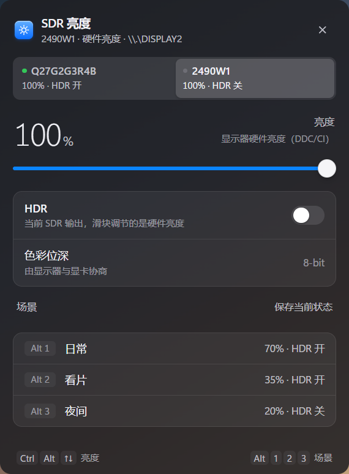
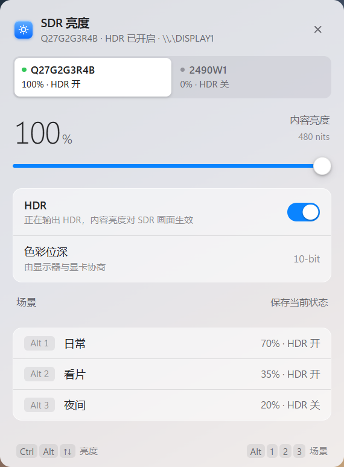
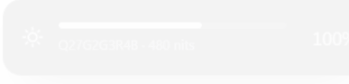

# SDR 亮度 · sdr-panel

Windows 上快速调「SDR 内容亮度」并切换 HDR 的托盘小工具。Electron + koffi 直连 Win32
`DisplayConfig` API，没有原生插件、没有外部服务进程。

<p align="center">
  
  
  
</p>

## 它解决什么问题

Windows 11 把「SDR 内容亮度」藏在 `设置 → 系统 → 屏幕 → HDR` 里，改一次要点四层菜单。
这个工具把它压到托盘、全局热键和一块屏上 HUD：

- **托盘面板**：选屏、拖滑块、切 HDR，失焦自动收起
- **全局热键**：`Ctrl + Shift + Alt + ↑↓` 调亮度（每次 5%，按住连发），`Alt + 1/2/3` 切场景
- **屏幕 HUD**：改亮度时在鼠标所在屏顶部闪一条磨砂条，1.5 秒后自动消失
- **场景预设**：一键切「日常 / 看片 / 夜间」，每块屏各自记自己的值和 HDR 状态
- **多屏**：面板里显式选一块「目标屏」，热键和场景都按这块屏走

## 两种调光路径

亮度不是只有一条路，程序按每块屏的实际状态自动分流：

| 屏的状态 | 走哪条路 | 面板显示 |
| --- | --- | --- |
| HDR 开着 | `DisplayConfigSetDeviceInfo(SET_SDR_WHITE_LEVEL)` —— SDR 白点 | `SDR 内容亮度 · 480 nits` |
| HDR 关着 / 不支持 HDR | `dxva2!SetMonitorBrightness` —— DDC/CI 硬件背光 | `亮度 · 显示器硬件亮度（DDC/CI）` |

SDR 白点只在 HDR 输出时才影响画面，所以纯 SDR 屏必须走 DDC 才有反应；反过来 HDR 开着时
显示器通常会拒绝 DDC 写。两条路都是实测出来的，不是推测。

## 两个 Windows 怪脾气（代码里都做了兜底）

**1. 私有枚举。** `SET_SDR_WHITE_LEVEL` 没有出现在公开的 `DISPLAYCONFIG_DEVICE_INFO_TYPE`
里，要用私有值 `0xFFFFFFEE`（按 int32 写就是 `-18`），结构体 28 字节，
`finalValue` 置 1 才提交。Twinkle Tray、HDRTray 用的是同一招。

**2. `GET_ADVANCED_COLOR_INFO` 写完不刷新。** 关掉 HDR 之后，`SET_HDR_STATE` 返回 0、
注册表 `HKLM\SYSTEM\CurrentControlSet\Control\GraphicsDrivers\MonitorDataStore\<id>\HDREnabled`
已经变成 0，但 `GET_ADVANCED_COLOR_INFO` 依然报 `enabled=1, bitsPerColor=10`，等 30 秒也不变。
如果拿它推导「目标值 = !当前值」，就会出现「切换成功但界面还显示开着，之后再点也切不动」。

处理办法在 `src/hdrstate.js`：每块屏记一条「我们最后写进去的值」，在系统读数追上之前以记录为准，
追上（重启后重新枚举）就自动作废。这段纯逻辑有单测：`node --test tools/hdrstate.test.js`。

**顺带一句假 HDR 的坑。** 有些显示器 EDID 声称支持 HDR，Windows 也会回「切换成功」，
但链路仍是 8-bit —— 画面根本没变。程序在开启后 1.6 秒回读，发现「说已开却还是 8-bit」
就自动回退、把这块屏标记为不可用，开关禁用并在旁边留一个「重试」。

## 开发

```bash
npm install
npm start                # 直接跑
npm run icon             # 重新生成托盘图标（手写 PNG，不依赖图形库）
npm test                 # hdrstate 单测
```

打包（Windows，出 NSIS 安装包 + 便携版）：

```bash
# 没有代码签名证书时 installer 会跳过签名，首次运行 SmartScreen 会警告「未知发布者」
ELECTRON_MIRROR=https://npmmirror.com/mirrors/electron/ \
ELECTRON_BUILDER_BINARIES_MIRROR=https://npmmirror.com/mirrors/electron-builder-binaries/ \
npx electron-builder --win --x64
```

调试用的环境变量（正式使用不会触发）：`SDR_DEV=1` 截图面板与 HUD、`SDR_DEV_BG=1` 注入假壁纸、
`SDR_DEV_THEME=dark|light` 强制主题、`SDR_NO_AUTOHIDE=1` 失焦不收起、`SDR_TRACE=1` 打印热键轮询。

## 结构

```text
src/display.js      koffi 封装：枚举显示器 / SDR 白点读写 / HDR 开关 / DDC 亮度
src/hdrstate.js     「写入值优先于系统读数」的纯逻辑（有单测）
src/store.js        settings.json（场景、选中的屏、HDR 记录、开机自启）
src/keys.js         GetAsyncKeyState 读物理键，兜住被占用的热键
src/main.js         托盘、面板窗、HUD、IPC、热键轮询
src/renderer/*      面板与 HUD 的界面（原生 HTML/CSS/JS，无框架）
tools/make-icon.js  生成托盘图标 PNG
```

## 已知限制

- 只做 Windows（全部是 Win32 API）
- 没有签名证书，安装包首次运行会有 SmartScreen 提醒
- `Ctrl + Alt + ↑↓` 常被显卡驱动的「屏幕旋转」热键占用，程序会自动退到 `Ctrl + Shift + Alt + ↑↓`，面板底部显示当前实际键位
- 部分显示器拒绝 DDC 写（尤其走某些转接器时），此时只能靠 SDR 白点那条路

## License

MIT
